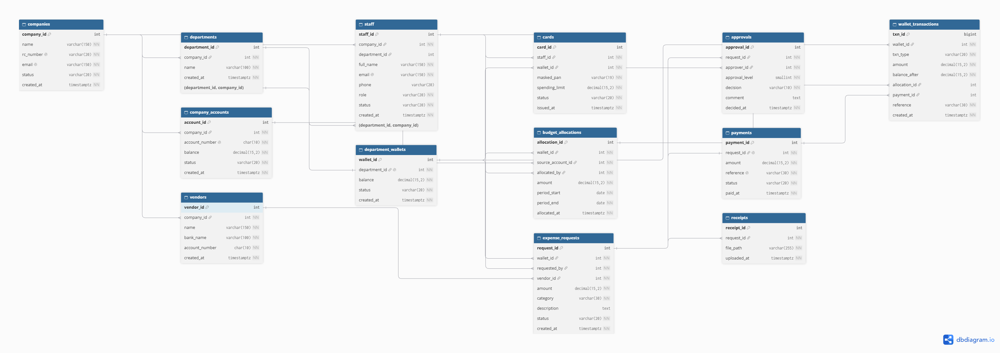
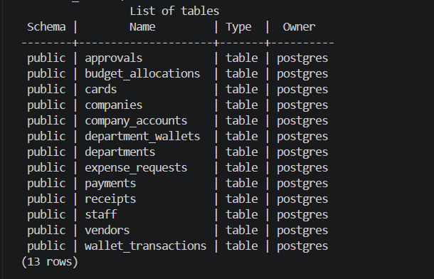
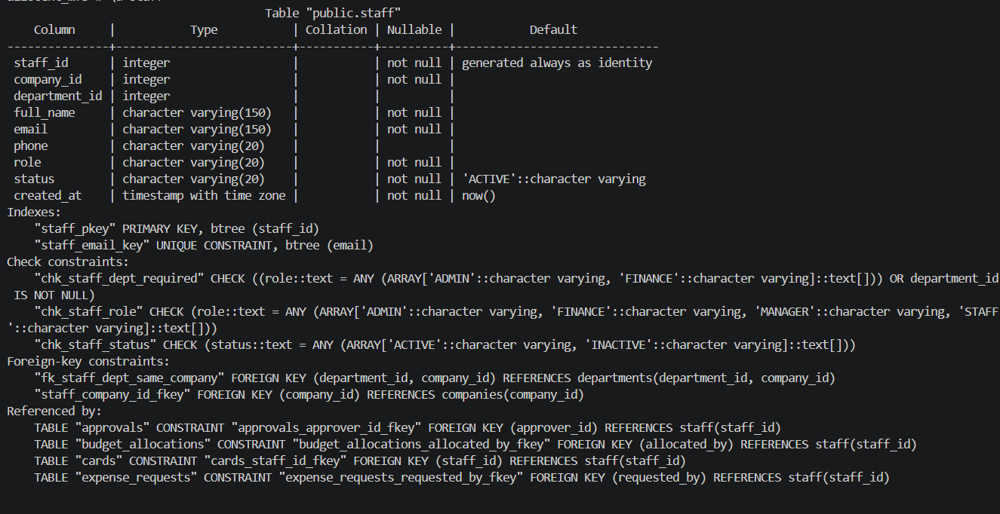
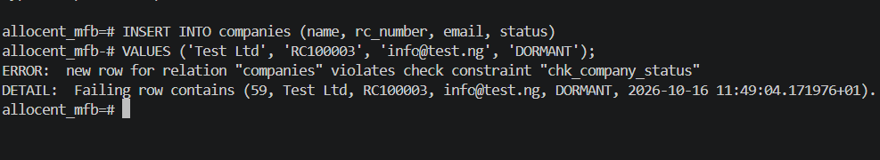
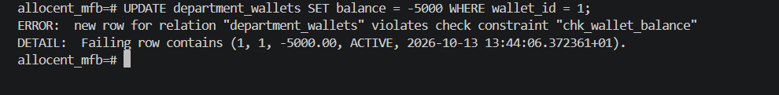
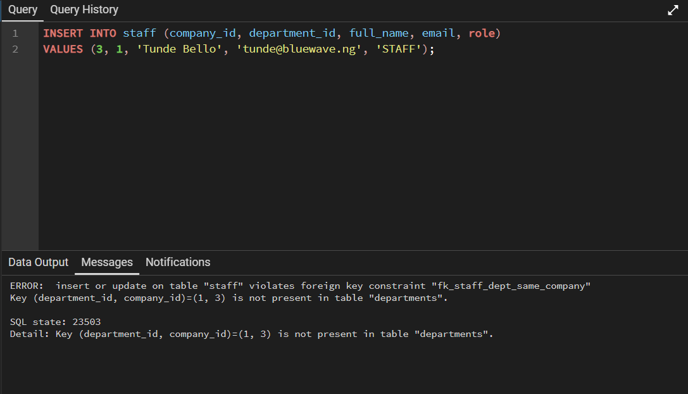
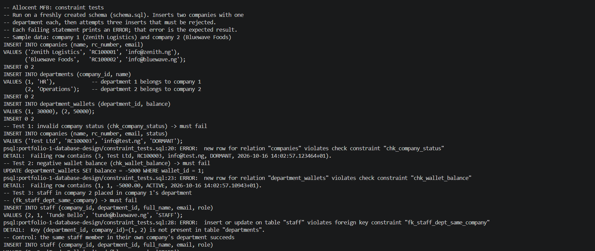

# Portfolio 1: Database Design and Modelling

## Case study
Allocent MFB is a fictional Nigerian digital microfinance bank offering a
multi-tenant spend management platform: companies allocate budgets from a
main business account to department wallets, staff raise expense requests,
managers (and finance, for large amounts) approve them, and approved requests
are paid to vendors from the wallet. The full case study, including users and
key operations, is in the [main README](../README.md#case-study).

## ER diagram

Source: [allocent_er.dbml](allocent_er.dbml), rendered with dbdiagram.io.

The model has 13 entities. Companies are the tenants; every other entity
belongs to a company directly or through a department, wallet or request.

| Entity | Purpose | Key relationships |
|---|---|---|
| companies | Tenant businesses | 1 → many departments, staff, accounts, vendors |
| departments | Units within a company | 1 → 1 department_wallet |
| staff | Users with a role | belong to a company; MANAGER/STAFF belong to a department |
| company_accounts | Main business account | source of budget allocations |
| department_wallets | Bank-held department budget | 1 → many requests, ledger entries, cards |
| budget_allocations | Money moved from account to wallet | account → wallet, made by a staff member |
| vendors | Payees, owned by a company | 1 → many requests |
| expense_requests | A request to spend from a wallet | 1 → many approvals, receipts; 1 → 0..1 payment |
| approvals | Manager (level 1) / finance (level 2) decisions | at most one per level per request |
| payments | Payment of an approved request | at most one per request |
| wallet_transactions | Ledger of every wallet movement | links to its allocation or payment |
| cards | Cards issued to staff against a wallet | staff → wallet |
| receipts | Files attached to a request | many per request |

## Normalisation

### Starting point: an unnormalised expense sheet
Without a database design, Allocent's expenses might be tracked in one sheet:

| request_id | company_name | dept_name | requester_name | requester_email | vendor_name | vendor_account | amount | approvers | receipts |
|---|---|---|---|---|---|---|---|---|---|
| 1 | Zenith Logistics | HR | Ada Obi | ada@zenith.ng | PrintHub | 0123456789 | 45,000 | Musa (Manager) | r1.jpg |
| 2 | Zenith Logistics | HR | Ada Obi | ada@zenith.ng | PrintHub | 0123456789 | 150,000 | Musa (Manager), Kemi (Finance) | r2.jpg, r3.jpg |

This design suffers from three anomalies:
- **Update anomaly:** if PrintHub changes its account number, every row
  mentioning PrintHub must be updated; missing one leaves conflicting data.
- **Insertion anomaly:** a new vendor or staff member cannot be recorded
  until an expense request involving them exists.
- **Deletion anomaly:** deleting Ada's only request would also delete the
  record that she exists.

### First Normal Form (1NF)
A table is in 1NF when every column holds a single atomic value and there
are no repeating groups. The `approvers` and `receipts` columns above hold
lists. In the Allocent schema, each approval is a separate row in
`approvals` and each receipt is a separate row in `receipts`, both linked
to their request through `request_id`. Every table has a primary key and
every column holds one value.

### Second Normal Form (2NF)
A table is in 2NF when it is in 1NF and no non-key column depends on only
part of a composite key. In `approvals`, the pair `(request_id,
approval_level)` uniquely identifies a row (enforced by
`uq_one_approval_per_level`). If `approvals` also stored the request's
`amount`, that value would depend on `request_id` alone, a partial
dependency. The amount is therefore kept only in `expense_requests`, and
the remaining columns in `approvals` (approver, decision, comment) depend
on the whole key. All tables also use single-column surrogate primary
keys, which avoids partial dependencies on the primary key.

### Third Normal Form (3NF)
A table is in 3NF when it is in 2NF and no non-key column depends on
another non-key column (a transitive dependency). In the sheet above,
`vendor_account` depends on `vendor_name`, not on `request_id`. In the
Allocent schema:
- Vendor details live in `vendors`; `expense_requests` stores only `vendor_id`.
- Requester details live in `staff`; `expense_requests` stores only `requested_by`.
- Company details live in `companies`; other tables store only `company_id`.
- `payments` deliberately has no `wallet_id`, because the wallet is
  reachable through `payments.request_id → expense_requests.wallet_id`.
  Storing it again would create a transitive dependency and a risk of the
  two values disagreeing.

### Deliberate denormalisation
Three design choices intentionally store derivable data, for practical reasons:
- **`department_wallets.balance`** could be calculated from the ledger, but
  is stored so balances can be read instantly, as in real banking systems.
  Consistency is protected by updating the balance and writing the ledger
  entry in the same transaction (see Portfolio 3).
- **`wallet_transactions.balance_after`** records the balance at the moment
  of each movement, giving an audit snapshot that does not need recalculating.
- **`staff.company_id`** is derivable through the department, but is needed
  because ADMIN and FINANCE staff have no department. The composite foreign
  key `fk_staff_dept_same_company` guarantees it can never contradict the
  department's company.

## Relational schema
The schema is implemented in [schema.sql](schema.sql): 13 tables with primary
keys, foreign keys and named constraints, created inside a single transaction.
The script is re-runnable because it drops existing tables first.

## Keys and Constraints

**Primary keys:** every table uses a single-column surrogate key
(`INT GENERATED ALWAYS AS IDENTITY`, `BIGINT` for the high-volume ledger).
Surrogate keys never change, keep foreign keys small, and avoid using
business values such as emails or account numbers, which can change, as keys.
Natural identifiers are still protected with `UNIQUE` constraints.

**Foreign keys:** every relationship is enforced with `REFERENCES`, so a
request cannot point to a missing wallet, staff member or vendor, and a
ledger entry cannot point to a missing allocation or payment.

**Composite foreign key for tenant isolation:** `departments` has
`UNIQUE (department_id, company_id)`, and `staff` references that pair
through `fk_staff_dept_same_company`. A plain FK on `department_id` would
allow a staff member of company 2 to be placed in company 1's department;
the composite FK makes that impossible at database level.

| Constraint | Table | Type | Business rule enforced |
|---|---|---|---|
| `chk_company_status` | companies | CHECK | A company is ACTIVE, SUSPENDED or CLOSED |
| `rc_number`, `email` | companies | UNIQUE, NOT NULL | One registration per company |
| `uq_dept_name_per_company` | departments | UNIQUE | No duplicate department names within a company |
| `fk_staff_dept_same_company` | staff | Composite FK | Staff can only join a department of their own company |
| `chk_staff_role` | staff | CHECK | Roles are ADMIN, FINANCE, MANAGER or STAFF |
| `chk_staff_dept_required` | staff | CHECK | Managers and staff must have a department |
| `chk_account_balance`, `chk_wallet_balance` | accounts, wallets | CHECK | Balances can never go negative (no overspending) |
| `department_id UNIQUE` | department_wallets | UNIQUE | Exactly one wallet per department |
| `chk_allocation_period` | budget_allocations | CHECK | A budget period must end after it starts |
| `uq_vendor_per_company` | vendors | UNIQUE | A company cannot register the same bank account twice |
| `chk_vendor_account`, `chk_account_number` | vendors, accounts | CHECK | NUBAN account numbers are exactly 10 digits |
| `chk_request_amount`, `chk_payment_amount` | requests, payments | CHECK | Amounts must be positive |
| `chk_request_status` | expense_requests | CHECK | Lifecycle: PENDING, APPROVED, REJECTED, PAID |
| `uq_one_approval_per_level` | approvals | UNIQUE | One decision per approval level per request |
| `chk_approval_level` | approvals | CHECK | Only two levels: manager (1) and finance (2) |
| `request_id UNIQUE` | payments | UNIQUE | A request can be paid at most once |
| `chk_txn_balance_after` | wallet_transactions | CHECK | The ledger never records a negative balance |
| `chk_txn_source` | wallet_transactions | CHECK | Each ledger entry links to the correct source record for its type |
| `chk_card_masked` | cards | CHECK | Only masked card numbers are stored, never full PANs |

## Design decisions
- **Roles in one `staff` table:** all users share the same attributes, so
  role is a checked column rather than four tables. `department_id` is
  nullable only for company-wide roles (ADMIN, FINANCE), enforced by
  `chk_staff_dept_required`.
- **Approvals as separate rows:** each decision is its own row with level,
  approver and time, giving a maker-checker audit trail. Requiring level 2
  (finance) approval for requests above ₦100,000 is an application rule: the
  schema allows at most one decision per level (`uq_one_approval_per_level`),
  but no constraint checks the amount threshold.
- **Ledger (`wallet_transactions`):** every wallet movement is recorded and
  never overwritten, so balances can be audited and reconstructed.
  `chk_txn_source` ties each entry to the allocation or payment that caused it.
- **Vendors owned by companies:** each tenant manages its own payees, so
  `vendors.company_id` keeps one company's vendors invisible to another.
- **Stored balances:** see Deliberate denormalisation above.
- **Money as `NUMERIC(15,2)`:** exact decimal arithmetic, never floating point.
- **Shared-schema multi-tenancy:** all companies share the same tables, with
  `company_id` identifying each tenant's data. This is simpler to build and
  operate than a separate schema or database per company, and tenant
  isolation is enforced in the database by `fk_staff_dept_same_company`.

## Evidence
Constraint tests are in [constraint_tests.sql](constraint_tests.sql).

| Test | Expected result | Screenshot |
|---|---|---|
| `\dt` | All 13 tables listed |  |
| `\d staff` | Columns and constraints |  |
| Invalid company status | Rejected by `chk_company_status` |  |
| Negative wallet balance | Rejected by `chk_wallet_balance` |  |
| Staff in another company's department | Rejected by `fk_staff_dept_same_company` |  |

**Full test run on a fresh schema:** `constraint_tests.sql` was run against a
newly created schema. The sample-data inserts succeed, the three invalid
statements are rejected, and the control insert succeeds.
- Output: [results/constraint_tests_output.txt](results/constraint_tests_output.txt)
- Screenshot: 

## How to run
1. Create the database:
   `psql -U postgres -h localhost -c "CREATE DATABASE allocent_mfb;"`
2. Create the schema (re-runnable; it drops existing tables first):
   `psql -U postgres -h localhost -d allocent_mfb -f portfolio-1-database-design/schema.sql`
3. Check the tables: `psql -U postgres -h localhost -d allocent_mfb -c "\dt"`
4. Run the constraint tests (three statements should fail with an ERROR):
   `psql -U postgres -h localhost -d allocent_mfb -f portfolio-1-database-design/constraint_tests.sql`
5. Re-run step 2 before loading Portfolio 2's test data.