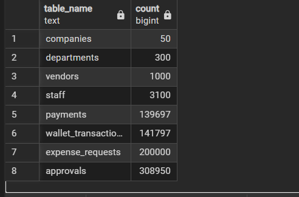

# Portfolio 2: Query Processing and Optimisation 
## Overview
This portfolio measures how PostgreSQL 18 executes five realistic Allocent MFB
queries on a large dataset, designs indexes from the execution plans, and
compares performance before and after optimisation.

## Test data
Indexes make no measurable difference on small tables, so a realistic dataset
was generated with `seed_data.sql` (pure SQL using `generate_series`, seeded
with `setseed(0.42)` so it is reproducible).

| Table | Rows |
|---|---|
| companies | 50 |
| departments / wallets | 300 |
| staff | ~3,100 |
| vendors | 1,000 |
| expense_requests | 200,000 |
| approvals | ~230,000 |
| payments | ~140,000 |
| wallet_transactions | ~142,000 |

The data respects every constraint from Portfolio 1, including non-negative
running balances in the ledger. Counts were verified with `row_counts.sql`.

## The five business queries
Defined in `queries.sql`; results in `results/query_results.txt`.

| # | Query | Business purpose |
|---|---|---|
| Q1 | A staff member's 20 most recent requests | Staff "My Requests" screen |
| Q2 | One wallet's ledger entries for one month | Wallet statement |
| Q3 | Pending requests for one wallet | Manager's approval inbox |
| Q4 | Spending per department for one company in one quarter | Finance report |
| Q5 | Top 5 vendors by total paid for one company | Vendor analysis |

## Method
1. Plans were captured with `EXPLAIN (ANALYZE, BUFFERS)` (`explain_queries.sql`),
   which runs each query and reports the real plan, timings and pages read.
2. Each set of plans was run once to warm the cache, then run again and saved,
   so all timings compare in-memory execution.
3. Three stages were measured:
   - **Before:** only primary-key and unique indexes (`results/before_plans.txt`)
   - **After indexes:** targeted indexes from `indexes.sql` (`results/after_plans.txt`)
   - **After covering:** covering indexes from `indexes_covering.sql`
     (`results/after_covering_plans.txt`)

## Baseline findings
PostgreSQL automatically indexes primary keys and unique columns, but not
foreign keys. Every query filtered on an unindexed foreign key
(`requested_by`, `wallet_id`, `vendor_id`), so each one performed a
**Parallel Seq Scan** of an entire large table to find a tiny fraction of rows.
For example, Q1 read about 199,900 rows (2,549 pages) to return 20.

## Indexes created

| Index | Definition | Designed for |
|---|---|---|
| `idx_requests_requester_created` | `expense_requests (requested_by, created_at DESC)` | Q1: filter and sort in index order, so no sort step is needed |
| `idx_wallet_txn_wallet_created` | `wallet_transactions (wallet_id, created_at)` | Q2: equality column first, range/sort column second |
| `idx_requests_pending_wallet` | `expense_requests (wallet_id, created_at) WHERE status = 'PENDING'` | Q3: partial index holding only pending rows |
| `idx_requests_wallet` | `expense_requests (wallet_id)` | Q4: find a company's requests by wallet |
| `idx_requests_vendor` | `expense_requests (vendor_id)` | Q5: find a company's requests by vendor |
| `idx_departments_company` | `departments (company_id)` | Q4: filter departments by company |
| `idx_requests_vendor_cover` | `expense_requests (vendor_id) INCLUDE (request_id)` | Q5: allow an index-only scan |
| `idx_payments_request_cover` | `payments (request_id) INCLUDE (paid_at, amount)` | Q4 and Q5: allow index-only payment lookups |

## Results

| Query | Before | After indexes | After covering | Plan change |
|---|---|---|---|---|
| Q1 | 65.45 ms | 0.149 ms | 0.150 ms | Parallel Seq Scan + Sort → Index Scan with no sort (~440× faster) |
| Q2 | 116.05 ms | 0.071 ms | 0.120 ms | Parallel Seq Scan + Sort → Index Scan (~1,600× faster) |
| Q3 | 82.57 ms | 0.300 ms | 0.243 ms | Parallel Seq Scan → Bitmap scan on the partial index (~275× faster) |
| Q4 | 126.23 ms | 49.76 ms | 16.76 ms | Seq Scan → Index Scan per wallet (~2.5×). The covering run used the identical plan and buffers, so the further drop is run-to-run variation, not the covering index |
| Q5 | 71.51 ms | 61.71 ms | 7.10 ms | Index ignored after the first round; covering index → Index Only Scan with 0 heap fetches (~10× faster than baseline) |

Pages read (buffers) fell from 2,549 to 24 for Q1, from 1,924 to 4 for Q2,
and from 2,549 to 49 for Q3. Q1–Q3 times in the covering run differ only by
fractions of a millisecond with identical plans, which is normal variation.

## Analysis

**Q1–Q3: highly selective queries benefit most.** Each needs a few dozen rows
out of 100,000+. The Q1 index stores each staff member's requests already
sorted newest first, so PostgreSQL reads the first 20 entries and stops. In
Q2, both the wallet and the date range became part of the index condition,
so only the 24 matching rows were read. Q3 used the partial index, which
contains only pending rows and is therefore small and fast.

**Q4: one bottleneck fixed, the next exposed.** The full scan of 200,000
requests was replaced by six index lookups (one per wallet), but most of the
remaining work came from 4,079 individual lookups into `payments` (11,037 of
14,611 pages), of which only 414 fell within the quarter. The `departments`
table was still read with a sequential scan despite `idx_departments_company`,
because with only 300 rows (3 pages), scanning is cheaper than using an index.

**Q5 (first round): the planner correctly ignored the index.** Company 7's
vendors account for about 4,079 requests (about 2% of the table), but those
rows are scattered across nearly all of the table's 2,511 pages. Fetching them
through the index would touch almost every page in random order, so a
sequential scan was cheaper. An index only helps when it lets the database
avoid reading most of the table; selectivity and physical row distribution
matter, not just whether an index exists.

**Covering indexes: one success, one unused.** For Q5,
`idx_requests_vendor_cover` changed the plan to an **Index Only Scan with
`Heap Fetches: 0`**: PostgreSQL read the request IDs directly from the index
without visiting the table, so reading request data cost 72 pages instead of
2,511, and execution time fell to 7.10 ms (about 10× faster than the
baseline). This solved the problem the plain index could not: scattered rows
no longer matter when the table is not read at all. Index-only scans depend on
the visibility map, which is why `VACUUM ANALYZE` was run first.

For Q4, the plan after the covering indexes was identical to the previous run,
with the same steps and the same 14,611 pages read; the planner still used
`payments_request_id_key` rather than `idx_payments_request_cover`. The lower
time (49.76 ms to 16.76 ms) therefore reflects run-to-run variation (a fully
warmed cache and tidier table pages after VACUUM), not the new index. This
shows why plans and buffer counts, not timings alone, should be used to judge
an optimisation.

## Trade-offs

Index usage and size (`pg_stat_user_indexes`, from `index_stats.sql`):

| Index | Times used | Size |
|---|---|---|
| idx_departments_company | 0 | 16 kB |
| idx_payments_request_cover | 4 | 6,752 kB |
| idx_requests_pending_wallet | 3 | 640 kB |
| idx_requests_requester_created | 3 | 6,184 kB |
| idx_requests_vendor | 4 | 1,376 kB |
| idx_requests_vendor_cover | 22 | 4,416 kB |
| idx_requests_wallet | 24 | 1,432 kB |
| idx_wallet_txn_wallet_created | 3 | 4,392 kB |

`times_used` counts every scan, including warm-up runs and repeated loops
inside a query, so it shows which indexes are used rather than exact
frequencies.

Table size vs index size:

| Table | Table size | Index size |
|---|---|---|
| expense_requests | 20 MB | 18 MB (~90%) |
| payments | 11 MB | 17 MB (~155%) |
| wallet_transactions | 15 MB | 7.5 MB (~50%) |

Indexes are a trade-off, not a free win. They make reads dramatically faster
but cost storage and slow down every insert and update, because each index
must be maintained. `payments` now holds more index data than table data, and
a payments system writes constantly, so each index must earn its place.
The partial index illustrates the opposite case: at 640 kB it is the smallest
request index, because it stores only pending rows, yet it made Q3 about
275× faster.

**Recommended production index set:**
- Keep `idx_requests_requester_created`, `idx_wallet_txn_wallet_created`,
  `idx_requests_pending_wallet`, `idx_requests_wallet` and
  `idx_requests_vendor_cover`.
- Drop `idx_requests_vendor`: fully superseded by the covering index.
- Drop `idx_departments_company`: never used; the table is too small to benefit.
- Drop `idx_payments_request_cover`: never chosen by the planner, so it adds
  6.8 MB and slows every payment insert for no benefit.

## Key lessons
- Foreign keys are not indexed automatically in PostgreSQL; filtering or
  joining on them at scale needs explicit indexes.
- Column order in a composite index matters: equality columns first, then
  range or sort columns, ideally matching the query's ORDER BY.
- Partial indexes give large gains at low cost when queries target a small,
  well-defined subset of rows.
- The planner may rightly ignore an index when rows are scattered or the
  table is tiny; covering indexes can change that by avoiding the table.
- Judge optimisations by plans and pages read, not timings alone, since
  timings vary between runs.

## Evidence
- `results/before_plans.txt`, `results/after_plans.txt`,
  `results/after_covering_plans.txt`, `results/query_results.txt`
- Screenshots in `screenshots/`: `row-counts.png`, `index-usage.png`, `table-sizes.png`

## How to run
From the repository root, after running Portfolio 1's `schema.sql`:

1. Load the test data:
   `psql -U postgres -h localhost -d allocent_mfb -f portfolio-2-query-optimisation/seed_data.sql`
2. Capture baseline plans (run once to warm the cache, then save):
   `psql -U postgres -h localhost -d allocent_mfb -f portfolio-2-query-optimisation/explain_queries.sql -o portfolio-2-query-optimisation/results/before_plans.txt`
3. Create the indexes:
   `psql -U postgres -h localhost -d allocent_mfb -f portfolio-2-query-optimisation/indexes.sql`
4. Repeat step 2, saving to `results/after_plans.txt`.
5. Create the covering indexes (the script also runs `VACUUM ANALYZE` to
   refresh the visibility map needed for index-only scans):
   `psql -U postgres -h localhost -d allocent_mfb -f portfolio-2-query-optimisation/indexes_covering.sql`
6. Repeat step 2, saving to `results/after_covering_plans.txt`.
7. Save the query results:
   `psql -U postgres -h localhost -d allocent_mfb -f portfolio-2-query-optimisation/queries.sql -o portfolio-2-query-optimisation/results/query_results.txt`
8. Check row counts, then index usage and sizes:
   `psql -U postgres -h localhost -d allocent_mfb -f portfolio-2-query-optimisation/row_counts.sql`
   `psql -U postgres -h localhost -d allocent_mfb -f portfolio-2-query-optimisation/index_stats.sql`
