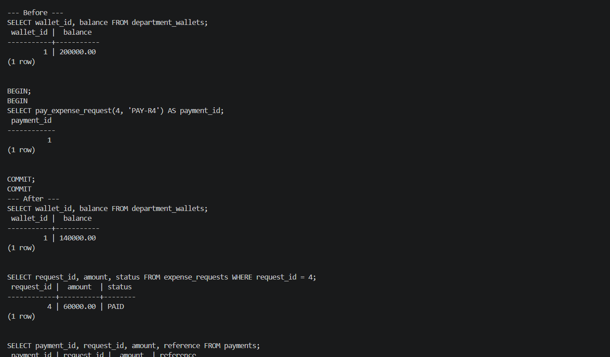
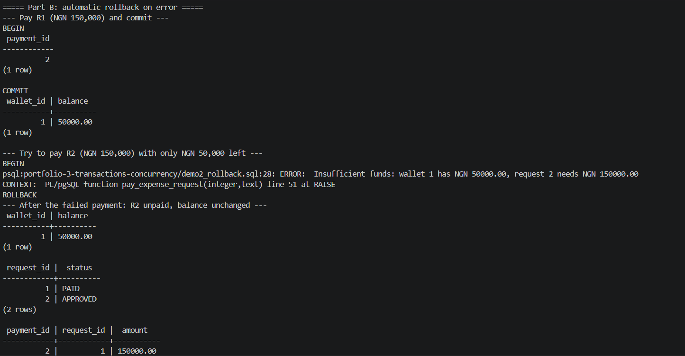
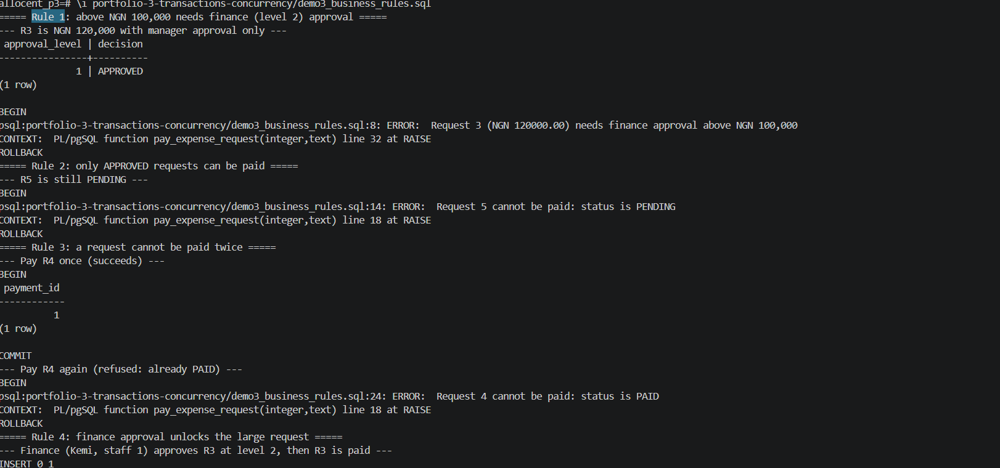
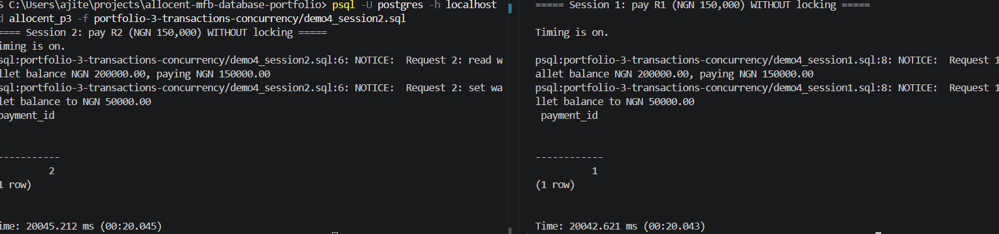
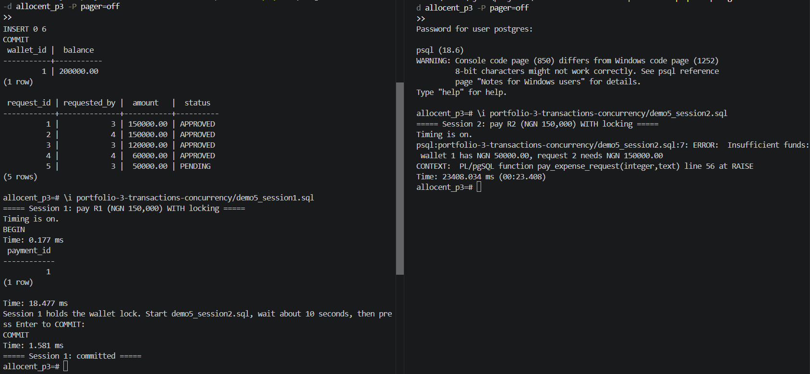
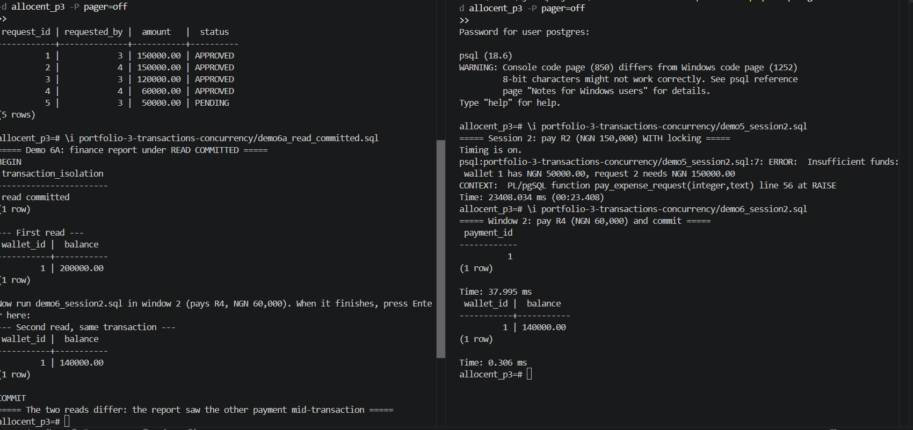
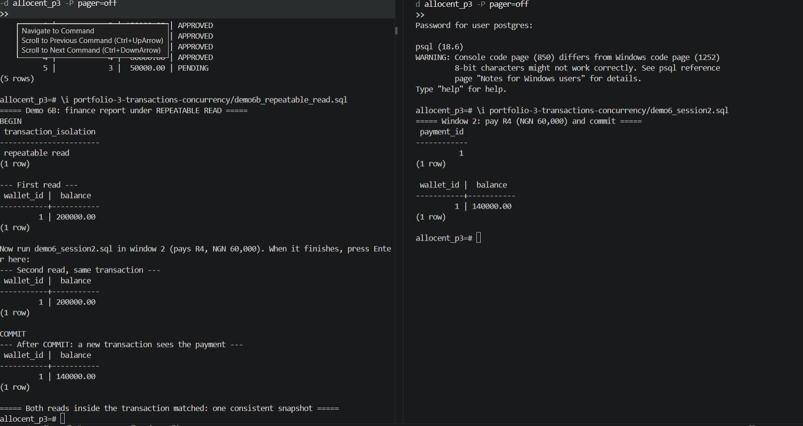

# Portfolio 3: Transactions and Concurrency

## Overview
Paying an expense request is the most important operation in Allocent MFB:
money leaves a department wallet and goes to a vendor. If it goes wrong, the
bank either loses money or records a payment that never happened. This
portfolio shows how PostgreSQL transactions keep that operation correct,
both on its own and when several people use the system at the same time.

| Requirement (brief) | Demo |
|---|---|
| Commit | Demo 1 |
| Rollback | Demo 2 (and the failed payments in Demo 3) |
| Business rules inside a transaction | Demo 3 |
| Concurrency issue | Demo 4: lost update without locking |
| Control mechanism | Demo 5: row locking with `SELECT ... FOR UPDATE` |
| Isolation | Demo 6: `READ COMMITTED` vs `REPEATABLE READ` |

All demos use a small, predictable dataset ([setup_demo.sql](setup_demo.sql))
in a separate database, `allocent_p3`, built from the Portfolio 1 schema:
one company, one HR wallet (wallet 1) holding **NGN 200,000**, and five
expense requests.

| Request | Amount (NGN) | Approvals | Used to show |
|---|---|---|---|
| R1 | 150,000 | manager + finance | Rollback, concurrency |
| R2 | 150,000 | manager + finance | Insufficient funds, concurrency |
| R3 | 120,000 | manager only | Finance approval rule |
| R4 | 60,000 | manager only | Commit, double payment, isolation |
| R5 | 50,000 | none (PENDING) | Only approved requests can be paid |

## The payment transaction
[pay_function.sql](pay_function.sql) defines `pay_expense_request(request_id,
reference)`. In one transaction it:

1. Locks the request row (`FOR UPDATE`) and checks it is `APPROVED`.
2. Checks the manager (level 1) approval, and the finance (level 2) approval
   for amounts above NGN 100,000. This enforces the rule that Portfolio 1
   describes as an application rule.
3. Checks the requester belongs to the wallet's department.
4. Locks the wallet row (`FOR UPDATE`), checks it is `ACTIVE` and has enough
   funds.
5. Makes four changes together: debits the wallet, inserts the payment,
   writes the ledger entry, and marks the request `PAID`.

Any failed check raises an exception, which aborts the whole transaction, so
the four changes happen together or not at all (**atomicity**). The rows are
always locked in the same order, request first and then wallet, so two
payments cannot lock them in opposite orders and deadlock each other.

## Demo 1: Commit
[demo1_commit.sql](demo1_commit.sql) pays R4 (NGN 60,000) and commits.

The wallet fell from 200,000 to 140,000, R4 became `PAID`, one payment row
was created, and a `PAYMENT` ledger entry recorded `balance_after = 140,000`.
All four changes are consistent with each other, and after `COMMIT` they are
permanent (**durability**).

Evidence: [results/demo1_commit.txt](results/demo1_commit.txt)

## Demo 2: Rollback
[demo2_rollback.sql](demo2_rollback.sql) has three parts.

- **Part A, manual rollback:** inside a transaction R1 is paid and the
  wallet shows 50,000. After `ROLLBACK` the wallet is back to 200,000, R1 is
  `APPROVED` again and there are no payments. Nothing from the transaction
  survived.
- **Part B, automatic rollback on error:** R1 is paid and committed (wallet
  50,000). Paying R2 (150,000) then fails with *Insufficient funds*. The
  script still sends `COMMIT`, but PostgreSQL replies `ROLLBACK`: a
  transaction that has hit an error can only be rolled back. R2 stays
  `APPROVED` and the balance stays 50,000.
- **Part C, the safety net:** an `UPDATE` that bypasses the function and
  tries to set the balance to -100,000 is rejected by the `chk_wallet_balance`
  CHECK constraint from Portfolio 1.

One detail is worth noting: the committed payment in Part B received
`payment_id = 2`, not 1. The ID used by the rolled-back payment in Part A was
not reused, because identity/sequence values are never rolled back. Gaps in
IDs are normal and do not mean data is missing.

Evidence: [results/demo2_rollback.txt](results/demo2_rollback.txt)

## Demo 3: Business rules inside the transaction
[demo3_business_rules.sql](demo3_business_rules.sql) checks that the
function refuses invalid payments and leaves no partial changes.

| Attempt | Result |
|---|---|
| Pay R3 (NGN 120,000, manager approval only) | Refused: needs finance approval above NGN 100,000 |
| Pay R5 (`PENDING`) | Refused: status is PENDING |
| Pay R4, then pay R4 again | First succeeds; second refused: status is PAID |
| Finance approves R3, then pay R3 | Succeeds |

Each refusal was followed by `ROLLBACK`. The final balance was
200,000 - 60,000 - 120,000 = **NGN 20,000**, with exactly two payments, so
no refused attempt changed any data (**consistency**).

Evidence: [results/demo3_business_rules.txt](results/demo3_business_rules.txt)

## Demo 4: Concurrency issue (lost update)
To show what goes wrong without locking,
[demo4_unsafe_function.sql](demo4_unsafe_function.sql) defines
`pay_expense_request_unsafe`: the same steps, but with **no `FOR UPDATE`**
and a 20-second pause between reading the balance and writing it (to
represent processing time, such as calling a payment provider). It exists
only for this demo.

Two sessions were started at almost the same time in two terminals:
session 1 paid R1 ([demo4_session1.sql](demo4_session1.sql)) and session 2
paid R2 ([demo4_session2.sql](demo4_session2.sql)), NGN 150,000 each.

- Both sessions read the balance as **200,000**, so both passed the funds
  check.
- Both calculated 200,000 - 150,000 and wrote **50,000**. The second write
  overwrote the first: a **lost update**.
- Both payments were recorded, each taking about 20 seconds, which shows
  they ran at the same time.

[concurrency_check.sql](concurrency_check.sql) compared the wallet with the
ledger afterwards:

| allocated | paid | expected balance | actual balance |
|---|---|---|---|
| 200,000 | **300,000** | **-100,000** | 50,000 |

The wallet paid out NGN 300,000 from a NGN 200,000 budget. The
`chk_wallet_balance` constraint did not catch it, because no single row
ever went negative: each session wrote a valid-looking 50,000. Constraints
check each row, not what concurrent transactions do together.

Evidence: [results/demo4_check.txt](results/demo4_check.txt)

## Demo 5: Control mechanism (row locking)
The same race was repeated with the real function, which locks the wallet
with `SELECT ... FOR UPDATE`.
[demo5_session1.sql](demo5_session1.sql) pays R1 inside an open transaction
and pauses before `COMMIT`, holding the lock.
[demo5_session2.sql](demo5_session2.sql) then tries to pay R2.

- Session 2 **waited**: it could not lock the wallet while session 1 held it.
- When session 1 committed, session 2 continued. Under `READ COMMITTED`, a
  `FOR UPDATE` read returns the latest committed version of the row, so it
  saw the real balance of **50,000** and failed with *Insufficient funds*.
- Session 2's time was **23,408 ms**: almost all of it spent waiting for
  the lock.

| | Demo 4 (no locking) | Demo 5 (`FOR UPDATE`) |
|---|---|---|
| Did session 2 wait? | No, both ran at once | Yes, 23.4 seconds |
| Balance session 2 used | 200,000 (out of date) | 50,000 (current) |
| Payments made | 2 (NGN 300,000) | 1 (NGN 150,000) |
| Wallet correct afterwards? | No | Yes, 50,000 |

**Locking makes payments from the same wallet take turns.** Only wallet 1
was locked, so payments from other wallets would not have been held up. The
cost is waiting: session 2 spent 23.4 seconds blocked, which is why the
payment transaction should do its work quickly and commit.

Evidence: [results/demo5_locking.txt](results/demo5_locking.txt)

## Demo 6: Isolation levels
A finance officer's report reads wallet 1's balance twice inside one
transaction. Between the two reads, another session pays R4 (NGN 60,000)
and commits ([demo6_session2.sql](demo6_session2.sql)).

| Isolation level | First read | Second read (same transaction) | After COMMIT |
|---|---|---|---|
| `READ COMMITTED` ([6A](demo6a_read_committed.sql)) | 200,000 | **140,000** | (not read) |
| `REPEATABLE READ` ([6B](demo6b_repeatable_read.sql)) | 200,000 | **200,000** | 140,000 |

- **`READ COMMITTED`** (PostgreSQL's default) takes a new snapshot for every
  statement, so the second read saw the other session's committed payment.
  This is a **non-repeatable read**: the same query in the same transaction
  gave two different answers. A report that adds up several such reads could
  be internally inconsistent.
- **`REPEATABLE READ`** takes one snapshot at the start of the transaction,
  so both reads returned 200,000, even though the payment had already
  committed. Once the transaction ended, a new read saw 140,000.

**Neither level is better in general; the right one depends on the task.**
Payments keep the default `READ COMMITTED` with explicit row locks (Demo 5),
because a payment must act on the latest balance. A report that runs several
queries and needs them to agree is safer under `REPEATABLE READ`.

## Key lessons
- A transaction makes the four payment steps all-or-nothing; after an
  error, even `COMMIT` returns `ROLLBACK`, because a failed transaction
  cannot be saved.
- CHECK constraints protect individual rows, not concurrent transactions; in
  Demo 4 every row was valid, yet NGN 300,000 left a NGN 200,000 wallet.
- Reading a balance and later writing a value calculated from it is unsafe
  under concurrency; `FOR UPDATE` makes the second session wait for the
  current value.
- Locking rows in a fixed order (request, then wallet) prevents two payments
  from deadlocking each other.
- Isolation level is a trade-off between the latest data and a stable
  snapshot; payments need the first, reports the second.

## Files
| File | Purpose |
|---|---|
| [setup_demo.sql](setup_demo.sql) | Resets the demo data (re-runnable) |
| [pay_function.sql](pay_function.sql) | Safe payment function with locking and business rules |
| [demo4_unsafe_function.sql](demo4_unsafe_function.sql) | Unsafe version without locks, for Demo 4 only |
| [concurrency_check.sql](concurrency_check.sql) | Compares wallet balance with allocations and payments |
| `demo*.sql` | The demos above |
| [results/](results/) | Text output of the demos |
| [screenshots/](screenshots/) | Screenshots of the demos |

## How to run
From the repository root:

1. Create the demo database and schema:
   `psql -U postgres -h localhost -c "CREATE DATABASE allocent_p3;"`
   `psql -U postgres -h localhost -d allocent_p3 -f portfolio-1-database-design/schema.sql`
2. Create the functions:
   `psql -U postgres -h localhost -d allocent_p3 -f portfolio-3-transactions-concurrency/pay_function.sql`
   `psql -U postgres -h localhost -d allocent_p3 -f portfolio-3-transactions-concurrency/demo4_unsafe_function.sql`
3. **Before every demo**, reset the data:
   `psql -U postgres -h localhost -d allocent_p3 -f portfolio-3-transactions-concurrency/setup_demo.sql`
4. Single-session demos (1, 2, 3), each after a fresh reset (step 3):
   - `psql -U postgres -h localhost -d allocent_p3 -P pager=off -f portfolio-3-transactions-concurrency/demo1_commit.sql`
   - `psql -U postgres -h localhost -d allocent_p3 -P pager=off -f portfolio-3-transactions-concurrency/demo2_rollback.sql`
   - `psql -U postgres -h localhost -d allocent_p3 -P pager=off -f portfolio-3-transactions-concurrency/demo3_business_rules.sql`
5. Two-session demos (4, 5, 6): open two terminals, start
   `psql -U postgres -h localhost -d allocent_p3 -P pager=off` in each, and
   run the scripts with `\i`:
   - **Demo 4:** run `demo4_session1.sql` in terminal 1, then
     `demo4_session2.sql` in terminal 2 within 20 seconds. Afterwards run
     `concurrency_check.sql`.
   - **Demo 5:** run `demo5_session1.sql` in terminal 1 and wait at its
     prompt; run `demo5_session2.sql` in terminal 2 (it waits); then press
     Enter in terminal 1.
   - **Demo 6:** run `demo6a_read_committed.sql` (or `demo6b_repeatable_read.sql`)
     in terminal 1 and wait at its prompt; run `demo6_session2.sql` in
     terminal 2; then press Enter in terminal 1.
