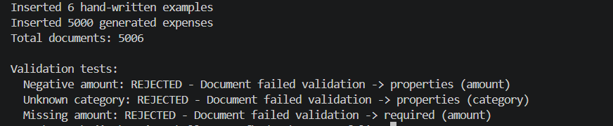
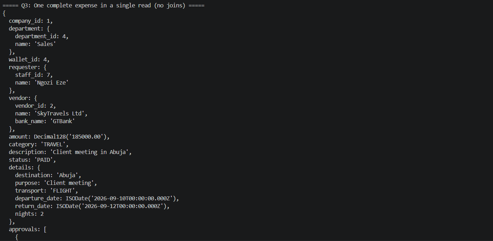
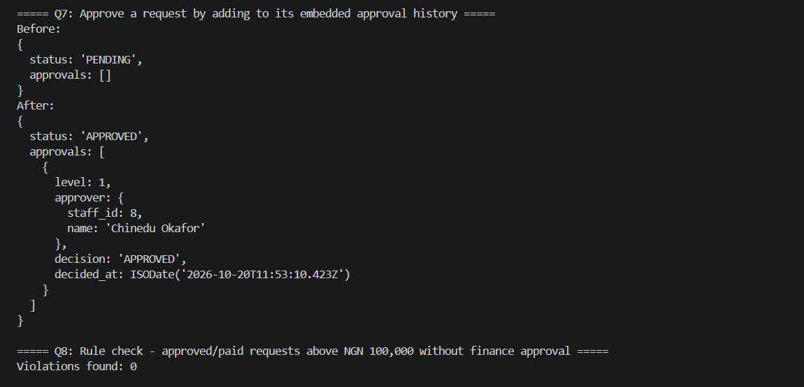
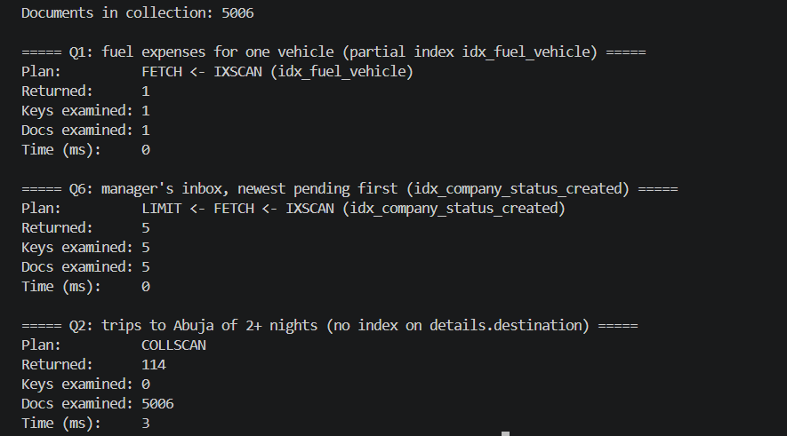

# Portfolio 4: NoSQL and Advanced Data Models

## Overview
For this portfolio I modelled the same Allocent MFB case study in
**MongoDB 8.0**, a document database. Each expense request becomes one
document that holds the request itself, its category-specific details, its
approval history and its receipts. The implementation includes schema
validation, indexes, 5,006 documents, queries, aggregations and `explain()`
output to show how the indexes are used.

## Why a document model
Expense requests are not all the same shape. A fuel expense records litres,
fuel type and the vehicle plate. A travel expense records the destination,
dates and number of nights. A software expense records the product, how many
licences and how long the subscription runs. In PostgreSQL I would
need either lots of mostly-empty columns or a separate table per category.
In MongoDB, each document just holds the fields it needs, all in one
collection.

## Data model

### One expense document
This is one of the hand-written examples (Q3 returns it in full):

```javascript
{
  company_id: 1,                                   // tenant, as in PostgreSQL
  department: { department_id: 4, name: "Sales" },
  wallet_id: 4,
  requester: { staff_id: 7, name: "Ngozi Eze" },
  vendor: { vendor_id: 2, name: "SkyTravels Ltd", bank_name: "GTBank" },
  amount: Decimal128("185000.00"),                 // exact decimal money
  category: "TRAVEL",
  description: "Client meeting in Abuja",
  status: "PAID",
  details: {                                       // varies by category
    destination: "Abuja", purpose: "Client meeting", transport: "FLIGHT",
    departure_date: ISODate("2026-09-10"), return_date: ISODate("2026-09-12"),
    nights: 2
  },
  approvals: [                                     // embedded history
    { level: 1, approver: { staff_id: 6, name: "Femi Balogun" },
      decision: "APPROVED", decided_at: ISODate("2026-09-05T10:00:00Z") },
    { level: 2, approver: { staff_id: 1, name: "Kemi Adeyemi" },
      decision: "APPROVED", decided_at: ISODate("2026-09-05T15:00:00Z") }
  ],
  receipts: [
    { file_path: "receipts/travel-0001.pdf", uploaded_at: ISODate("2026-09-13T09:00:00Z") },
    { file_path: "receipts/travel-0002.pdf", uploaded_at: ISODate("2026-09-13T09:05:00Z") }
  ],
  created_at: ISODate("2026-09-04T09:00:00Z")
}
```

### Category-specific details
The fields inside `details` depend on the category. The six hand-written
examples use the full set below; the 5,000 generated documents use a smaller
subset of each.

| Category | Fields in `details` |
|---|---|
| FUEL | litres, fuel_type, vehicle_plate, odometer_km |
| TRAVEL | destination, purpose, transport, departure_date, return_date, nights |
| SOFTWARE | product, licences, subscription_months, billing, renewal_date |
| EQUIPMENT | item, quantity, unit_price, serial_numbers (array), warranty_months |
| UTILITIES | provider, meter_number, billing_period, units_kwh |
| OTHER | note, attendees |

### Embedding vs referencing

| Data | Choice | Reason |
|---|---|---|
| Approvals | Embedded array | Always read with the request, never exist on their own, and small (at most two levels) |
| Receipts | Embedded array | Belong to one request and are read with it; the files themselves stay in object storage |
| Details | Embedded object | Unique to each expense |
| Requester, vendor, department | Embedded snapshot (ID + name) | Keeps the names as they were when the request was made, for audit; the IDs still point to the master records |
| Wallet balances, payments | **Not in MongoDB** | Kept in PostgreSQL, where ACID transactions and row locking protect the money (see Portfolio 3) |

## Schema validation
MongoDB is schema-flexible, not schema-less. A `$jsonSchema` validator in
`01_setup.js` enforces the fields every expense must have, while leaving
`details` free to change by category:

- Required: company, department, wallet, requester, vendor, amount, category,
  status and creation date.
- `amount` must be a positive `Decimal128` (exact decimal, like `NUMERIC(15,2)`).
- `category` and `status` must be one of the allowed values.
- Each approval must have a level of 1 or 2, a decision and a date.

I tested the validator with three invalid documents in `02_insert.js`. All
three were rejected, and each error names the rule that was broken:

| Test | Result |
|---|---|
| Negative amount | Rejected: `properties (amount)` |
| Unknown category (`PARTY`) | Rejected: `properties (category)` |
| Missing amount | Rejected: `required (amount)` |

Output: [results/insert_output.txt](results/insert_output.txt)



## Indexes

| Index | Keys | Purpose |
|---|---|---|
| `idx_company_status_created` | company_id, status, created_at (desc) | Manager's inbox: filter by tenant and status, newest first |
| `idx_company_category` | company_id, category | Category reports per company |
| `idx_fuel_vehicle` | details.vehicle_plate, **partial** (FUEL only) | Fuel lookups by vehicle; only fuel documents go into the index |

Output: [results/setup_output.txt](results/setup_output.txt)

## Queries and results
Full output: [results/queries_output.txt](results/queries_output.txt)

| Query | What it shows |
|---|---|
| Q1: fuel expenses for one vehicle | Querying a field that only fuel documents have |
| Q2: trips to Abuja of 2+ nights | Querying travel-only fields; 114 matching trips |
| Q3: one complete expense | Request, details, two approvals and two receipts in **one read, with no joins** |
| Q4: paid spend per department | Aggregation pipeline (`$match`, `$group`, `$sort`), MongoDB's version of GROUP BY |
| Q5: spend by category | Totals and averages calculated exactly with `Decimal128` |
| Q6: manager's inbox | Newest pending requests for one company |
| Q7: approve a request | `$push` adds an approval to the embedded history and `$set` changes the status, in one atomic update |
| Q8: ₦100,000 rule check | 0 approved or paid requests above ₦100,000 are missing a finance approval |





## Index evidence
Full output: [results/explain_output.txt](results/explain_output.txt)

| Query | Plan | Docs examined | Returned |
|---|---|---|---|
| Q1: fuel by vehicle | IXSCAN on `idx_fuel_vehicle` (partial) | 1 | 1 |
| Q6: manager's inbox | IXSCAN on `idx_company_status_created`, then LIMIT | 5 | 5 |
| Q2: Abuja trips (no index) | COLLSCAN | 5,006 | 114 |

The two indexed queries looked at exactly the documents they returned. The
unindexed one had to read every document in the collection. For Q6, the
compound index matches both the filter and the sort order, so MongoDB reads
the five newest pending requests straight from the index without a sort
step. This is the same principle as the `(requested_by, created_at DESC)` index in
Portfolio 2. The times are all close to 0 ms because the collection is
small, so "docs examined" is the more useful number here.



## Why a document model suits this data

1. **Variable structure.** Each category has its own fields. One collection
   holds all of them, with no nullable columns, no extra tables and no schema
   change when a new category is added.
2. **The way the data is read matches the document.** Reviewing an expense
   always needs its details, approvals and receipts together. With embedding
   that is a single read (Q3). In PostgreSQL the same view needs joins across
   several tables (requests, approvals, receipts, staff, vendors and
   departments).
3. **History fits naturally.** The approval history is an ordered list that
   only grows. An embedded array with `$push` (Q7) models that directly, and
   the update is atomic because it only touches one document.
4. **Flexible, but with guardrails.** The validator still enforces the money,
   category and status rules, so the flexibility applies only where it is needed.
5. **Splits easily by tenant.** Every document has a `company_id`, which
   makes it a natural shard key for spreading data across servers
   (Portfolio 5).

## Trade-offs and what stays in PostgreSQL

- **Money stays relational.** Wallet balances, payments and the ledger need
  multi-row ACID transactions, row locking and cross-table constraints.
  Portfolio 3 showed what happens without locking (a lost update) and how
  `FOR UPDATE` prevents it. MongoDB does support multi-document transactions,
  but for a bank's balances the relational model with row locks and foreign
  keys is the safer choice.
- **Duplication.** Vendor and requester names are copied into each document.
  That is on purpose, for audit history, but it means a renamed vendor is not
  updated in older documents.
- **No foreign keys.** MongoDB does not check that a `vendor_id` or
  `wallet_id` actually exists. The application has to take care of that.
- **Rules across documents.** Anything that spans documents, such as a wallet
  balance limit, cannot be enforced by the validator.

**Using both (polyglot persistence).** A realistic Allocent system would use
both databases: PostgreSQL as the system of record for balances, payments and
the ledger, and MongoDB for the varied expense details and receipts. Each one
does the job it is best at.

**Other models considered.** A **graph database** such as Neo4j would suit
fraud detection, for example spotting staff who keep paying the same vendor,
or a vendor whose bank account matches an employee's. Questions about
relationships like these are slow as repeated SQL joins but natural as graph
traversals.

## How to run
From the repository root, in PowerShell:

1. Start Docker Desktop, then start MongoDB with this folder mounted as
   `/scripts`:
   `docker run -d --name allocent-mongo -p 27017:27017 -v "${PWD}\portfolio-4-nosql:/scripts" mongo:8.0`
2. Create the collection, validator and indexes:
   `cmd /c "docker exec allocent-mongo mongosh --quiet /scripts/01_setup.js > portfolio-4-nosql\results\setup_output.txt"`
3. Insert the documents and run the validation tests:
   `cmd /c "docker exec allocent-mongo mongosh --quiet /scripts/02_insert.js > portfolio-4-nosql\results\insert_output.txt"`
4. Run the queries (the script resets the request that Q7 approves, so it
   can be run more than once):
   `cmd /c "docker exec allocent-mongo mongosh --quiet /scripts/03_queries.js > portfolio-4-nosql\results\queries_output.txt"`
5. Show index usage:
   `cmd /c "docker exec allocent-mongo mongosh --quiet /scripts/04_explain.js > portfolio-4-nosql\results\explain_output.txt"`

`cmd /c` is used because PowerShell's own `>` saves files as UTF-16, which
GitHub does not display properly.

## Evidence
- Scripts: [01_setup.js](01_setup.js), [02_insert.js](02_insert.js),
  [03_queries.js](03_queries.js), [04_explain.js](04_explain.js)
- Output: [setup_output.txt](results/setup_output.txt),
  [insert_output.txt](results/insert_output.txt),
  [queries_output.txt](results/queries_output.txt),
  [explain_output.txt](results/explain_output.txt)
- Screenshots: [insert-and-validation.png](screenshots/insert-and-validation.png),
  [queries-q3.png](screenshots/queries-q3.png),
  [queries-q7.png](screenshots/queries-q7.png),
  [explain.png](screenshots/explain.png)
