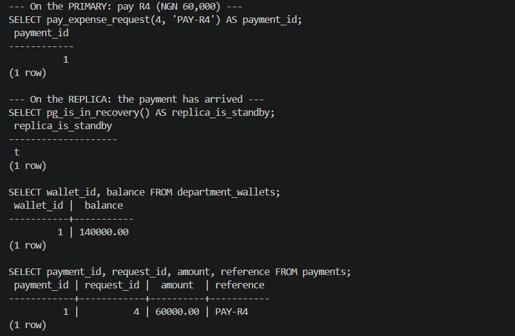
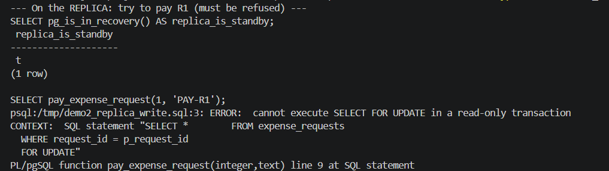
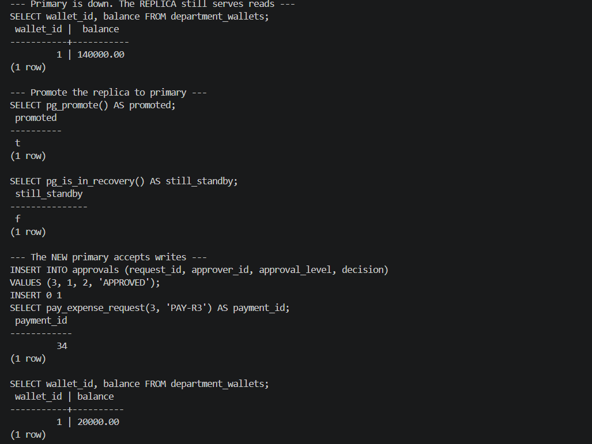

# Portfolio 5: Distributed and Cloud Database

## What I set out to do
For this portfolio I wanted to move Allocent off a single database server and
see what actually happens when the data lives on more than one machine. I set
up a PostgreSQL primary with a streaming replica using Docker Compose, loaded
the same Allocent schema and demo data from Portfolios 1 and 3, and then tested
three things: whether changes really reach the replica, whether the replica
protects itself from writes, and whether Allocent can keep running when the
primary goes down. The second half of this README covers the parts I discussed
rather than built: consistency trade-offs, sharding by company and deploying
to the cloud.

## The setup
Two PostgreSQL 18 containers run side by side:

| Container | Role | Port on my machine |
|---|---|---|
| `pg-primary` | Accepts all reads and writes | 5433 |
| `pg-replica` | Read-only copy that streams every change from the primary | 5434 |

The files that make this work:

- `docker-compose.yml` starts both containers. The primary runs with
  `wal_level=replica` so it records enough information for a replica to follow it.
- `primary-init/01-replication.sh` runs once on the primary. It creates a
  `replicator` user and allows it to connect for replication.
- `replica-entrypoint.sh` waits for the primary, clones it with
  `pg_basebackup -R`, and then starts as a standby. The `-R` option writes the
  settings that keep the replica connected and streaming.

The passwords in these files are demo values for local containers only.

One thing that caught me out: the two `.sh` scripts failed at first because
Windows saves files with CRLF line endings, and Linux containers need LF.
I added a `.gitattributes` file (`*.sh text eol=lf`) so Git always keeps them
in the right format.

The replica's startup log ([results/replica_startup_log.txt](results/replica_startup_log.txt))
shows the whole process: it waits for the primary, copies it, enters standby
mode, and finishes with `started streaming WAL from primary`. The WAL
(write-ahead log) is PostgreSQL's record of every change, and streaming it is
how the replica stays up to date.

## Demo 1: Changes on the primary reach the replica
I paid request R4 (₦60,000) on the primary, then queried the replica, which I
had never loaded any data into directly.

| | Primary | Replica |
|---|---|---|
| Action | `pay_expense_request(4, 'PAY-R4')` | Read only |
| Wallet balance | 140,000.00 | 140,000.00 |
| Payment PAY-R4 | Created | Present |

The schema, the demo data, the payment function and the payment itself all
arrived on the replica through replication.

Evidence: [results/demo1_replication.txt](results/demo1_replication.txt)



## Demo 2: The replica refuses writes
I tried to pay request R1 on the replica:

```
ERROR:  cannot execute SELECT FOR UPDATE in a read-only transaction
```

`pg_is_in_recovery()` returned `t`, confirming it was running as a standby.
This is what I want for a bank: only one server can change balances, so there
is always a single source of truth. The replica is still useful for reads,
such as Allocent's spending reports and dashboards, which takes that load off
the primary.

Evidence: [results/demo2_read_only.txt](results/demo2_read_only.txt)



## Demo 3: Failover when the primary goes down
I stopped the primary container to simulate a crash, then worked only with the
replica:

1. **Reads kept working.** The replica still returned the wallet balance
   (₦140,000) with the primary down.
2. **I promoted the replica.** `pg_promote()` returned `t`, and
   `pg_is_in_recovery()` changed to `f`, so it was no longer a standby.
3. **Writes worked again.** Finance approved R3 at level 2, R3 (₦120,000) was
   paid, and the balance dropped to ₦20,000.

The same server that refused writes in Demo 2 accepted them after promotion,
so Allocent could keep processing payments with its original primary offline.

Evidence: [results/demo3_failover.txt](results/demo3_failover.txt)



**Something I didn't expect:** the new payment got ID 34, not 2. I looked into
it and found that PostgreSQL logs identity values to the WAL in batches of 32
rather than one at a time. After a failover, the promoted server skips past
the batch the old primary might already have handed out, so no ID can ever be
used twice. The trade-off is a gap. The lesson for me was that identity values
are unique but not gapless, which is another reason Allocent uses its own
payment references (like `PAY-R3`) for auditing instead of relying on IDs.

**What I'd watch out for in production:** after a failover, the old primary
must not simply be restarted, because two servers both accepting writes would
give conflicting balances (split brain). I rebuilt both containers from
scratch afterwards for that reason. In a real system a tool such as Patroni,
or a managed cloud service, would handle detection, promotion and fencing off
the old primary automatically.

## Consistency: asynchronous vs synchronous replication
My setup uses **asynchronous** replication (`sync_state = async`). The primary
confirms a commit as soon as it has written it, without waiting for the
replica. This is fast, but there is a small window where a payment is
confirmed on the primary and not yet on the replica. If the primary crashed
in that window, the promoted replica would be missing that payment.

PostgreSQL can switch to **synchronous** replication by setting
`synchronous_standby_names`. Then the primary waits for the replica to confirm
each commit before telling the application it succeeded. No confirmed payment
can be lost, but if the replica is down, the primary cannot commit at all.

For Allocent I'd choose differently for different data:

| Data | Choice | Why |
|---|---|---|
| Wallet balances, payments, ledger | Synchronous, with at least two replicas | A confirmed payment must never disappear; two replicas mean one failure doesn't stop payments |
| Spending reports and dashboards | Read from asynchronous replicas | A report that is a second behind is acceptable |

There is also a practical catch with reading from replicas: if a staff member
pays a request and the app immediately reads their balance from a replica, it
might show the old balance for a moment. Reads that must reflect a user's own
recent change (read-your-writes) should go to the primary.

## CAP trade-offs
The CAP theorem says that when a network partition splits the servers, a
system has to choose between consistency (everyone sees the same correct data)
and availability (every request gets an answer).

- **Balances and payments choose consistency.** It is better for a payment to
  fail and be retried than for two servers to approve spending from the same
  wallet. This is the same problem as the lost update in Portfolio 3, just
  across servers instead of sessions.
- **Reporting can choose availability.** Showing a dashboard that is slightly
  out of date is better than showing nothing.

## Sharding by company
Replication copies all the data to every server. It helps with availability
and read load, but every server still holds everything. As Allocent grows,
the next step would be **sharding**: splitting the data so each server holds
only part of it.

The natural shard key is `company_id`:

- **Every table already has it**, directly or through a department or wallet,
  because the design is multi-tenant (Portfolio 1).
- **Almost every query filters by it.** A company's staff only ever see their
  own company's wallets, requests and payments.
- **A payment never crosses companies.** The request, wallet, approvals,
  payment and ledger entries for one payment all belong to one company, so
  they would live on the same shard, and the transaction from Portfolio 3
  would still run on a single server with full ACID guarantees.

| Shard | Holds |
|---|---|
| Shard 1 | Companies 1–1,000 (or hash of company_id) |
| Shard 2 | Companies 1,001–2,000 |
| Shard 3 | ... |

Things I'd need to handle:

- **Large tenants.** One very big company could overload its shard. Hashing
  the company ID spreads companies more evenly than ranges, and a very large
  tenant could be given a shard of its own.
- **Bank-wide queries.** Reports across all companies, such as total spend
  for the bank, would have to query every shard and combine the results.
- **Tooling.** PostgreSQL doesn't shard on its own; an extension such as
  Citus would distribute tables by `company_id`. In Portfolio 4, every MongoDB
  document also carries `company_id`, so it could be used as the shard key
  there too.

## Deploying to the cloud
My setup runs on one laptop, so both "servers" share the same machine. That is
fine for showing how replication works, but it is not truly distributed:
if my laptop goes down, both go with it. A real deployment would use a managed
PostgreSQL service such as Amazon RDS, Azure Database for PostgreSQL or Google
Cloud SQL, which provide:

- **High availability across zones:** a standby in a separate data centre,
  with automatic failover, which is what I did by hand in Demo 3.
- **Read replicas** for reporting.
- **Automated backups and point-in-time recovery**, so data can be restored
  to a moment before a mistake. Replication alone does not protect against a
  bad delete, because the replica copies the delete too.
- **Encryption** at rest and in transit, and network access controls.

For a Nigerian bank, the choice of region also matters: customer financial
data must be handled in line with the Nigeria Data Protection Act 2023 and
CBN requirements, which affects where data can be stored and replicated.

## What I learned
- Replication is easy to describe but has real details: WAL, base backups,
  standby mode and replication users all have to be set up correctly.
- A replica is not a backup. It copies mistakes as faithfully as good changes.
- Failover keeps a system available, but promotion has to be handled
  carefully to avoid split brain.
- The consistency choice should depend on the data. For money, I'd always
  give up some availability rather than risk two servers disagreeing about a
  balance.

## How to run
From this folder, with Docker Desktop running:

1. Start the primary and replica:

```
   docker compose up -d
```

2. Check the replica is streaming (wait about 30 seconds first):

```
   docker exec pg-replica psql -U postgres -c "SELECT status, sender_host FROM pg_stat_wal_receiver;"
```

3. Load Allocent onto the primary:

```
   docker cp ..\portfolio-1-database-design\schema.sql pg-primary:/tmp/
   docker cp ..\portfolio-3-transactions-concurrency\setup_demo.sql pg-primary:/tmp/
   docker cp ..\portfolio-3-transactions-concurrency\pay_function.sql pg-primary:/tmp/
   docker exec pg-primary psql -U postgres -d allocent -f /tmp/schema.sql
   docker exec pg-primary psql -U postgres -d allocent -f /tmp/setup_demo.sql
   docker exec pg-primary psql -U postgres -d allocent -f /tmp/pay_function.sql
```

4. Copy the demo files into the containers:

```
   docker cp demo1_primary.sql pg-primary:/tmp/
   docker cp demo1_replica.sql pg-replica:/tmp/
   docker cp demo2_replica_write.sql pg-replica:/tmp/
   docker cp demo3_promote.sql pg-replica:/tmp/
   docker cp demo3_write.sql pg-replica:/tmp/
```

5. Run the demos:

```
   docker exec pg-primary psql -U postgres -d allocent -e -f /tmp/demo1_primary.sql
   docker exec pg-replica psql -U postgres -d allocent -e -f /tmp/demo1_replica.sql
   docker exec pg-replica psql -U postgres -d allocent -e -f /tmp/demo2_replica_write.sql
   docker stop pg-primary
   docker exec pg-replica psql -U postgres -d allocent -e -f /tmp/demo3_promote.sql
   docker exec pg-replica psql -U postgres -d allocent -e -f /tmp/demo3_write.sql
```

6. Rebuild cleanly afterwards (never restart the old primary next to the
   promoted replica):

```
   docker compose down
   docker compose up -d
```

## Evidence
- Results: `results/replica_startup_log.txt`, `results/replication_status.txt`,
  `results/demo1_replication.txt`, `results/demo2_read_only.txt`,
  `results/demo3_failover.txt`
- Screenshots: `screenshots/demo1-replication.png`,
  `screenshots/demo2-read-only.png`, `screenshots/demo3-failover.png`